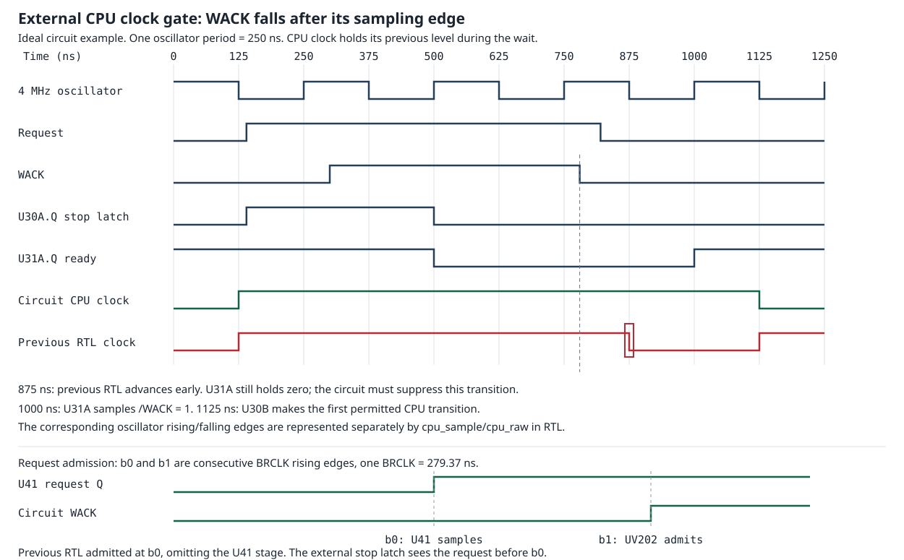

# External CPU clock gate

Source: `refs/seanriddle.com/videobrain.xlsx`, parts and all connections sheets.
The following are board pin connections, not a fit to measured halt costs.
U30 is 74LS73; U31 is 74LS74. Their edge and clear polarities agree with
[TI LS73A](https://www.ti.com/lit/ds/symlink/sn74ls73a.pdf) and
[TI LS74A](https://www.ti.com/lit/ds/symlink/sn74ls74a.pdf).

| Element | Connected pins | Operation |
| --- | --- | --- |
| U28D | 11/12 = unsynchronized CPUREQ1/0; 13 -> U30.1 | Invert the combined request |
| U30A | U30.14 (J1)=1, .3 (K1)=0, .1 (CLK1)=U28.13 | Set Q on request rising |
| U33D, U31A | U11.8 (WACK) -> U33.9; U33.8 -> U31.2 (D1); U31.3 (CLK1)=4 MHz | Sample inverted WACK on oscillator rising |
| U40B | Inputs U31.5 (Q1) and reset; U40.6 -> U30.2 (/CLR1) | Clear U30A while sampled WACK is high or reset is active |
| U40A | Inputs U31.5 (Q1) and U30.13 (/Q1); U40.3 -> U30.7 (J2)/.10 (K2) | Enable CPU divider only when ready and no latched request |
| U30B | U30.5 (CLK2)=4 MHz, .6 (/CLR2)=1, .9 (Q2) -> F3850.38 (XTLY) | Toggle CPU clock on oscillator falling, if enabled |
| U41 | U41.9 (CLK)=BRCLK; .3 (D1)/.4 (D2)=requests; .2 (Q1)/.5 (Q2) -> UV202.CPUREQ0/1 | Synchronize requests separately from the immediate stop latch |

The CPU clock divider holds its existing level; it is not cleared on a wait.
The two oscillator polarities are distinct. A raw CPU half-clock enable
represents an oscillator falling edge, not both oscillator edges.



The diagram is an ideal 4 MHz example, excluding gate propagation. The FPGA
quantizes both oscillator polarities to MCLK while preserving their order.

| Edge | External circuit | Previous RTL |
| --- | --- | --- |
| Request rises | U30A.Q becomes 1; next CPU toggle blocked | `cpu_req` immediately asserts arbiter stall |
| First BRCLK rising after request | U41 captures request; UV202 still sees previous Q | UV202 admits request immediately, one BRCLK early |
| Second BRCLK rising | UV202 admits the sampled request | Service has already begun |
| WACK rises | Wait for oscillator rising to sample it | Stall remains asserted |
| Next oscillator rising | U31.Q becomes 0; U30A clears; U31 keeps divider disabled | No corresponding state transition |
| Request falls before any WACK | U30A retains the stop | Level-based stall releases; an incorrect CPU edge is possible |
| WACK falls after an oscillator rising | U31.Q remains 0 | Grant immediately releases stall |
| Following oscillator falling | CPU must remain held | CPU can advance here: the incorrect early transition |
| Next oscillator rising | U31.Q becomes 1 | No corresponding state transition |
| Following oscillator falling | First permitted CPU toggle | CPU has already advanced one half-clock in this release phase |

`uv202_cpu_gate.vhd` implements the U30A/U31A state. `uv202_clkgen.vhd`
adds the opposite oscillator edge without changing the raw 4 MHz enable
sequence, BRCLK or bus service lengths. `uv202_top.vhd` adds the U41 request
sample before arbiter admission. The CPU and bus interface consume the
same gated enable. RES1 requests no buffered access and retains zero waits.
No empirical restart delay is added.

Run `make test-cpu-gate` from `verilator`. Its event-driven reference uses
the board's separate D-flop, JK-flop, clear and enable nets. It checks every
MCLK against the implementation over 64 request offsets and 12 service
lengths, request withdrawal before WACK, reset during a wait, and another
halt after reset. The previous gate is checked with the same stimuli and
the grant held until the request drops. Results on 2026-10-19:

- Corrected gate: 76,742 edge decisions, zero mismatches.
- Previous gate: 391 mismatches, including 385 premature WACK restarts.
- U41 sampling/admission edges pass at 16 request offsets.
- CPU interrupt phases, 320-phase ROM IRQ chain, F3853, arbiter, fetcher/DMA
  and four fixed-program CPU-to-DAC tests pass.
- Full-core VHDL analysis/elaboration and the raw CPU clock check pass.

The existing production CPU/bus test still rejects the documented halt cost:

| Access | Previous lost half-clocks | Corrected lost half-clocks |
| --- | --- | --- |
| RES1 read | 0 | 0 |
| RAM/cart/RES2 read | 4..5 | 6..7 |
| RAM write | 5 | 6..7 |
| UV201 read | 5..10 | 7..11 |
| UV201 write | 6..10 | 8..9 |

These ranges cover 128 reset offsets without DMA. The RAM/cart assertion
still requires 7..9 half-clocks; it has not been relaxed. The missing WACK
sample and U41 input stage are demonstrated sequencing defects, but their
correction does not reconcile the entire sunk cost. Propagation-sensitive
behavior described in
`videobrain_unwrapped.txt` is also outside the ideal circuit model.

Full-ROM IRQ/audio effect is pending the longer capture. Run from the root
in WSL:

```sh
sh verilator/audio_cpu_gate_capture.sh
```

It preserves `out/audio_bus_timing` as the baseline and writes to
`verilator/out/audio_cpu_gate`. It rebuilds the simulator, runs the same
unmodified ED01 ROM and key sequence through frame 342, then compares
frames 330..342. `comparison.txt` reports DAC periods, IRQ-to-ack min/median/
p95/max and counts over 40 us, plus exact held-DAC sidebands at +/-59.94 and
119.88 Hz in a common 0.005..0.200 s window. There is no synthetic retiming
or filtering. The comparator's saved-capture self-check reproduces the
94.705 us maximum and approximately -35 dBc sidebands with zero self-delta;
that check is not a measurement of the correction's audio effect.
